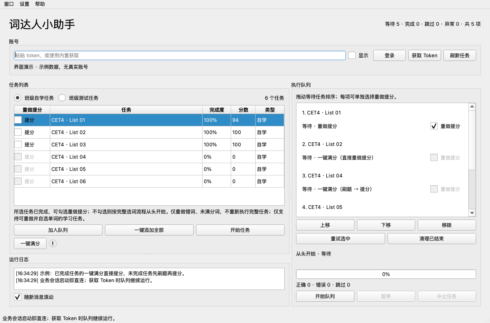
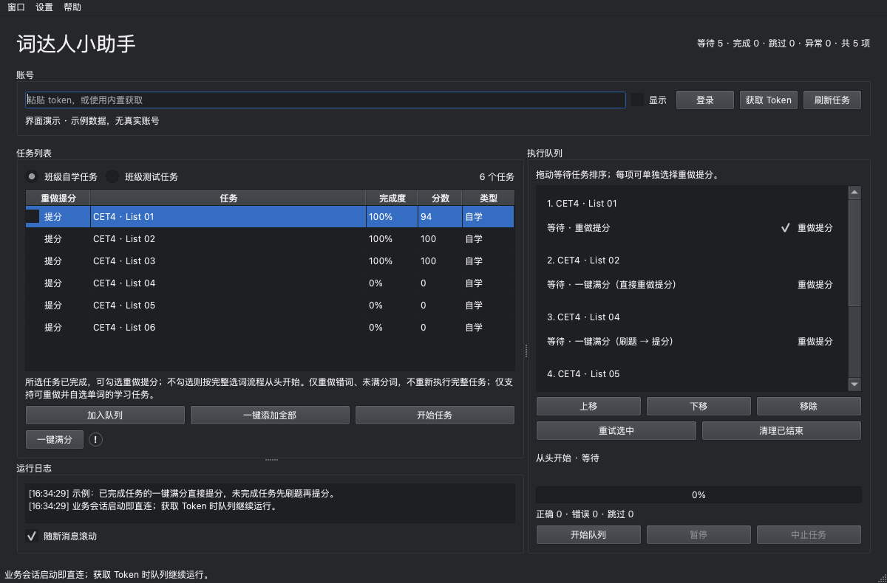

# 桌面与队列重构说明

本次在 `codex/assistant-desktop-refactor` 分支本地开发，基于完整整合版 `2e64cff`。未创建独立远程仓库，未推送代码。原有运行配置、答案库与词表池的未提交数据保留，不纳入重构提交。

## 模块边界

- `desktop/window.py`：原生 Qt 主界面，任务选择、队列展示、拖动排序、手动暂停与多开。
- `desktop/workers.py`：登录读取和队列的后台线程；每项运行前获取最新任务状态，执行结束持久化状态和报告。
- `core/engine.py`：独立于窗口的答题引擎，执行从头开始、只提分、一键满分三种目标。旧 `main.TaskWorker` 通过适配复用答题方法，兼容原有测试与旧入口。
- `core/queue.py`：可编辑、持久化队列及明确状态机，等待项排序、去重、领取、重试和中断恢复。
- `core/control.py`：用户主动暂停/继续/取消，暂停不消耗任务用时额度。
- `core/runtime.py`：账号执行互斥、运行目录、Token 捕获工具单实例；不暂停业务请求。
- `api/request_header.py`：按执行上下文创建与关闭业务会话，避免账号凭据互相替换。
- `api/network_retry.py`：默认直连、有界原地重试、写请求结果不明时不重放。
- `util/file_lock.py`：多进程共享 JSON 写入锁和原子替换；Windows 使用 LockFileEx，Unix 使用 flock。
- `util/word_cache.py`：沿用已审阅的 FIFO SQLite 查词缓存，不改变模型加载逻辑。

## 执行与恢复

等待 → 运行中 → 完成 / 跳过 / 失败 / 已取消 / 待核对提交 / 待安全验证 / 刷题完成但提分跳过。运行中可由用户手动暂停并在原调用栈继续。

一键满分根据每项启动前的最新完成度分流：进度达到 100% 直接提分，未完成才先续做当前刷题流程。任务列表和队列中的提分勾选都限于完成度 100% 的学习任务，队列模型和引擎也校验该条件。

每项最多执行一次任务流程。网络故障在当前请求层重试，上限 5 次；不以重新开始任务代替请求恢复。未知提交结果保留为待核对，不自动重放，队列继续下一项。安全验证或账号失效停止本轮请求并保留等待项。

提分流程最多 10 轮、30 分钟，连续两轮分数不提升即停止；同题最多出现三次。常规单项上限两小时。无法提分和提分无进展均写入结果，继续队列。原始全任务错题库仍跨任务、单元和重启保留；当前任务的临时推断与全局错题库各自遵循已有生命周期。

## 多窗口与共享存储

多个账号的队列相互独立，不同窗口可以并行执行。根据稳定学生标识生成账号键；缺少标识时才退回 Token 的散列。账号执行锁避免同一账号重复执行。队列文件每次修改先读最新版本，使用文件锁与原子替换合并多窗口操作；异常退出的运行项在下次取得账号锁后标记待核对。

答案库、错题记忆、词表池和查词缓存为所有窗口共用。JSON 写入获取短时文件锁，合并最新内容后原子替换；SQLite 事务保证 FIFO 计数与淘汰一致。写入失败记录原因，不让学习记忆的写入失败打断答题。不按账号复制答案库。

## 获取 Token 时保持运行

所有业务 RetryingSession 初始化即设置 `trust_env=False`，每次请求清除传入和会话代理，继续使用证书校验。Token 捕获工具仍按原流程临时设置并恢复系统代理，业务队列不订阅该状态、不自动暂停。

获取新 Token 时不更换正在运行的会话。捕获工具本身跨窗口互斥，其他账号的执行不需要等它释放。测试使用真实本地 HTTP 服务、无效环境和显式代理，确认业务请求直接到达目标且不读取环境代理；未在测试中修改用户系统代理或证书。

## 验证与边界

详细机器可读结果见 [desktop-refactor-validation.json](desktop-refactor-validation.json)。包含原有回归、队列状态、满分分流、拖动排序、跨进程共享写入、账号会话与重复执行保护、代理直连、FIFO 持久化缓存和设置归一化。

界面使用离屏渲染检查明暗主题；另启动两个实际桌面入口进程验证多开启动，测试结束仅关闭这些测试进程。Windows 文件锁实现需后续在 Windows 原生环境复核。

本次真实网络复测仅用于登录、读取任务和已有满分任务的提分前读取检查，未进行新的在线答题。复测中途已按用户要求停止，此后不再访问任何已保存 Token；不将这次复测记作完整在线验收。此前整合版 8 个任务全部 100 分的验证记录单独保留。

本次离线回归共 140 项通过。明暗主题预览使用示例数据，不含真实身份信息：

