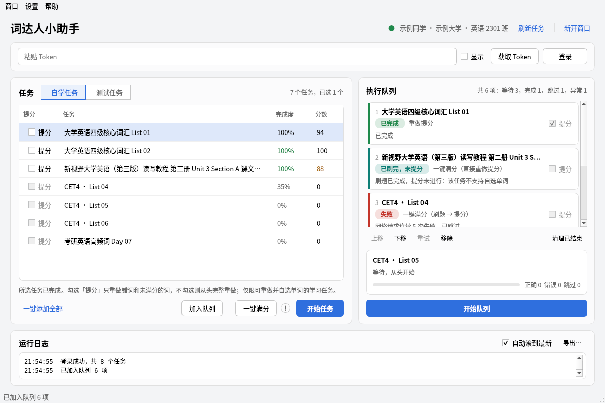
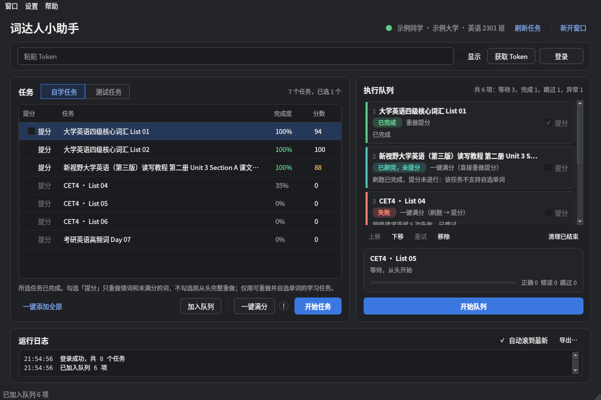
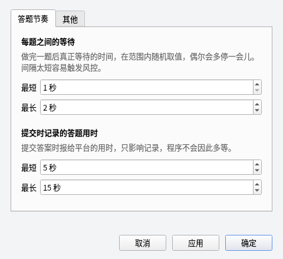
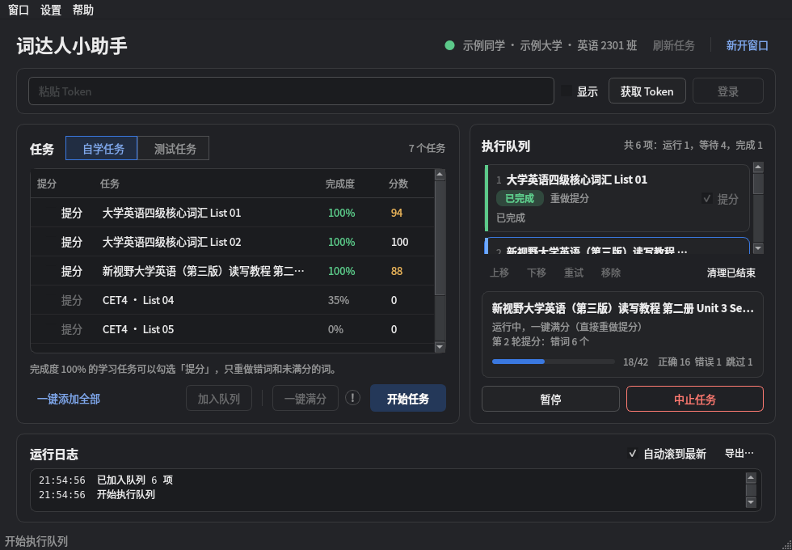

# 界面优化说明（2026-11）

本轮只调整界面布局、按钮层级和提示文案，队列、执行方式、重试与停止规则保持不变。任务约束见 [ui-optimization-handoff.md](ui-optimization-handoff.md)。

## 布局

顶部一行放应用名、当前账号、「刷新任务」和「新开窗口」，多开入口从菜单提到了界面上。Token 输入单独一栏，只有未登录或账号在其他窗口运行时才显示一行说明。

中间左右两栏：左边是任务，右边是执行队列。底部是运行日志，默认较矮，可以拖动分隔条调整；日志标题栏保留「自动滚到最新」和「导出…」。

任务列表上方用分段切换「自学任务 / 测试任务」，右侧显示任务数和已选数量。类型列已隐藏（与分段切换重复）。完成度 100% 显示为绿色，已完成但未满分的分数显示为橙色并附提示，方便找出可提分的任务。长任务名在表格和队列卡片中末尾省略，悬停可看完整名称。

队列每一项是一张卡片：序号、任务名、状态标签、执行方式，以及结束原因或最新进度。左侧色条和状态标签同时表示状态，状态也始终写成文字，不只依靠颜色。新开始执行的任务会自动滚到可见位置。

队列下方的详情区只在选中队列项或有任务运行时出现，显示状态、最新消息、进度条和正确 / 错误 / 跳过计数。没有任务时把空间留给队列。

## 按钮层级

每个区域只保留一个主按钮（实色）：未登录时是「登录」，任务区是「开始任务」，队列区是「开始队列」。

任务区左侧是「一键添加全部」（文字按钮），右侧依次为「加入队列」、分隔线、「一键满分」与圆圈感叹号、「开始任务」。没有选中任务时，「加入队列」「一键满分」「开始任务」置灰；「一键添加全部」仍然添加当前分类的全部任务，范围没有变化。

队列操作改为一行轻量按钮：上移、下移、重试、移除、清理已结束。按钮会根据选中项状态启用或置灰，例如运行中的项不能移除，第一个等待项不能上移，只有已结束的项可以重试。同样的操作也放进了右键菜单，Delete 键可移除选中项。

运行控制：空闲时只显示「开始队列」；运行中换成「暂停 / 继续」和「中止任务」（红色描边），避免三个按钮同时挤在一起。

## 文案

提示文字改成直接告诉用户结果或下一步，去掉了解释实现细节的长句。例如：

| 原文 | 现在 |
| --- | --- |
| 已加入 2 项；已排队的同模式任务会去重，提分仅支持学习任务 | 已加入队列 2 项，另有 1 项已在队列中 |
| 本轮队列执行结束；未执行项保留，失败和跳过项不会自动重跑 | 队列已全部执行完。1 项未完全成功，不会自动重跑，需要时选中后点「重试」 |
| 该账号已在其他窗口执行；当前窗口仅查看，不改动正在运行的队列 | 这个账号正在其他窗口运行，本窗口只能查看，不能修改队列 |
| 服务端有进行中小节：先续完该小节，再从头完整选词 | 有一个没做完的小节，先做完它，再从头完整选词 |
| 当前提交结果需核对，保留该项并继续队列，不自动重发 | 有一次提交没有收到确认，已标为「提交待核对」，不会自动重发，队列继续 |

「提分」和「一键满分」的说明保留原有含义：只重做错词和未满分的词；仅限可重做并自选单词的学习任务；一键满分在完成度 100% 时直接提分，未完成时先刷完再提分，耗时显著增加。

队列状态名称：「等待暂停」改为「正在暂停」，「待安全验证」改为「需安全验证」，「待核对提交」改为「提交待核对」，「刷题完成·提分跳过」改为「已刷完，未提分」。各结果仍分别显示。

涉及文字的文件：`desktop/window.py`、`desktop/workers.py`、`core/engine.py`（只改了跳过原因和提示的字符串）、`app_info.py`、`view/builtin_token.py`、`view/setting.py`。

## 首选项

改为可缩放的布局，分「答题节奏」和「其他」两页。「每题之间的等待」（实际等待）和「提交时记录的答题用时」（只报给平台，不会让程序多等）分开写明。原有字段、取值范围、校验和保存逻辑不变。修正了「恢复默认」之后错误提示显示成绿色的问题。

## 主题

新增 `desktop/theme.py`，所有颜色从系统调色板推导，跟随系统浅色 / 深色切换（系统切换时自动重建样式）。没有自绘标题栏，macOS 原生窗口按钮和菜单保持不变；「首选项」使用系统标准快捷键（macOS 上为 ⌘,）。

## 验证

`QT_QPA_PLATFORM=offscreen python3 -m unittest discover -s tests`：151 项通过（原有 149 项，新增 2 项：任务操作按钮与选中状态的关系、队列操作按钮随选中项状态变化）。

用示例数据（不登录、不联网）离屏渲染了浅色、深色，1200×800 与最小尺寸 980×680，覆盖长任务名、空队列 / 未登录、多项队列、运行、暂停、失败和「已刷完，未提分」。另外抽查了：未选中时加入队列只给提示；「开始任务」排在已有队列之后；切换到测试任务后「一键添加全部」只加当前分类；同模式重复加入会去重；账号在其他窗口运行时添加和开始按钮置灰；运行中「开始队列」隐藏、「暂停 / 继续」切换正确。

## 限制

截图在 Linux 离屏环境用 Fusion 风格和模拟调色板生成，macOS 上的控件外观（复选框、滚动条、字体）会以系统原生样式为准，建议在 macOS 浅色 / 深色下各打开一次确认。Fusion 深色调色板下表格里未选中的复选框边框偏淡，macOS 原生样式不受影响。

最小窗口尺寸下队列区可同时显示的卡片较少，可以拖动日志分隔条换取空间。

未改动 Token 捕获后端、代理与证书逻辑，也未改动根目录 README。
