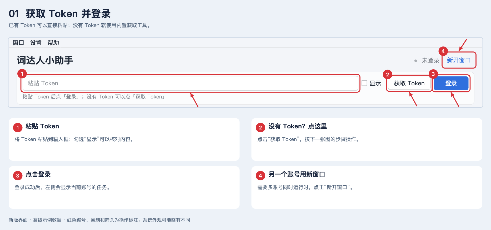
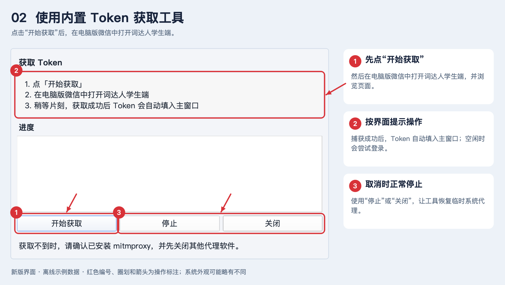
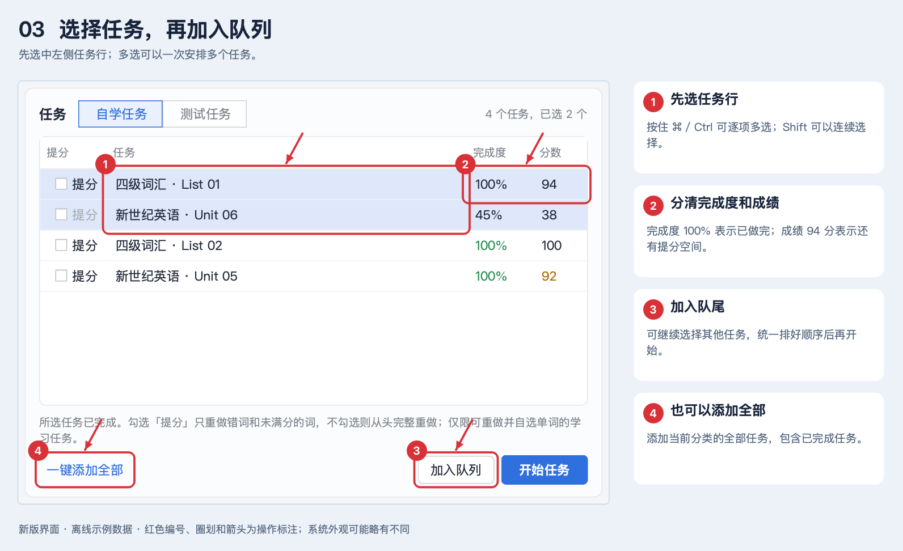
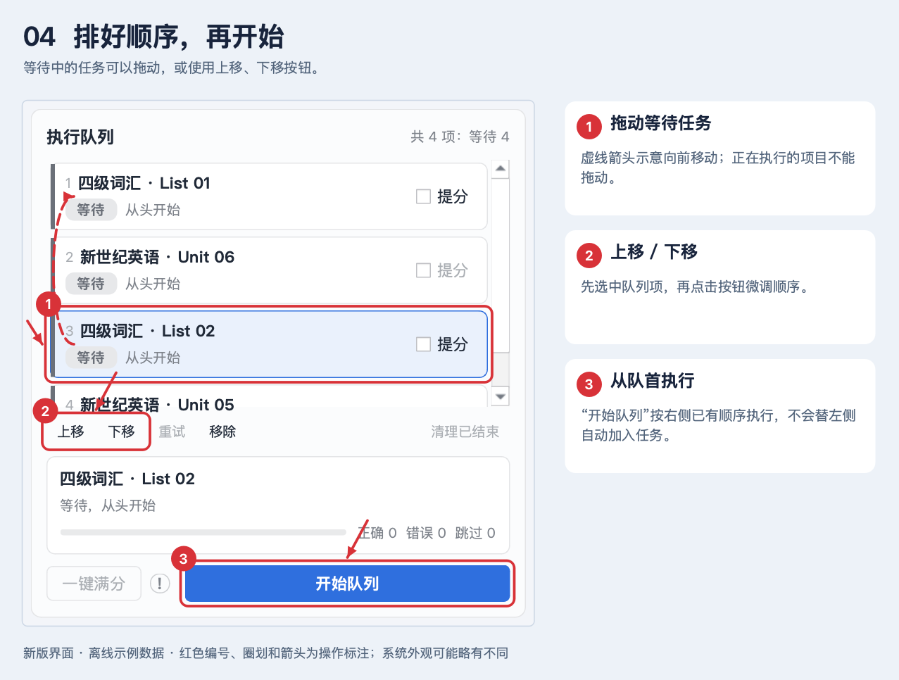
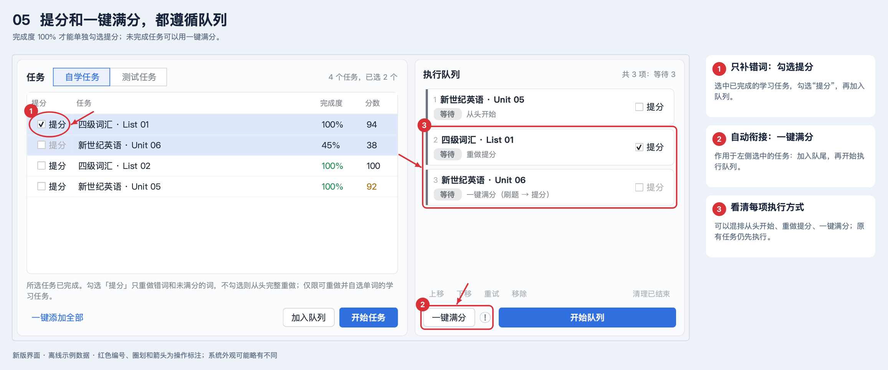
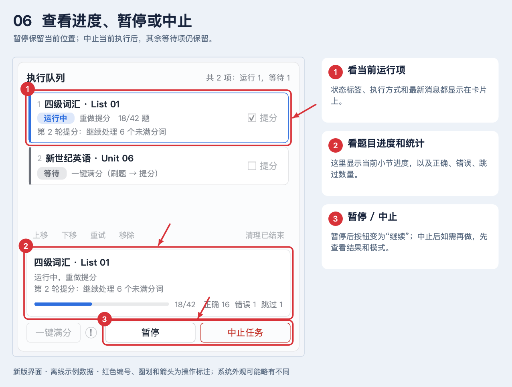
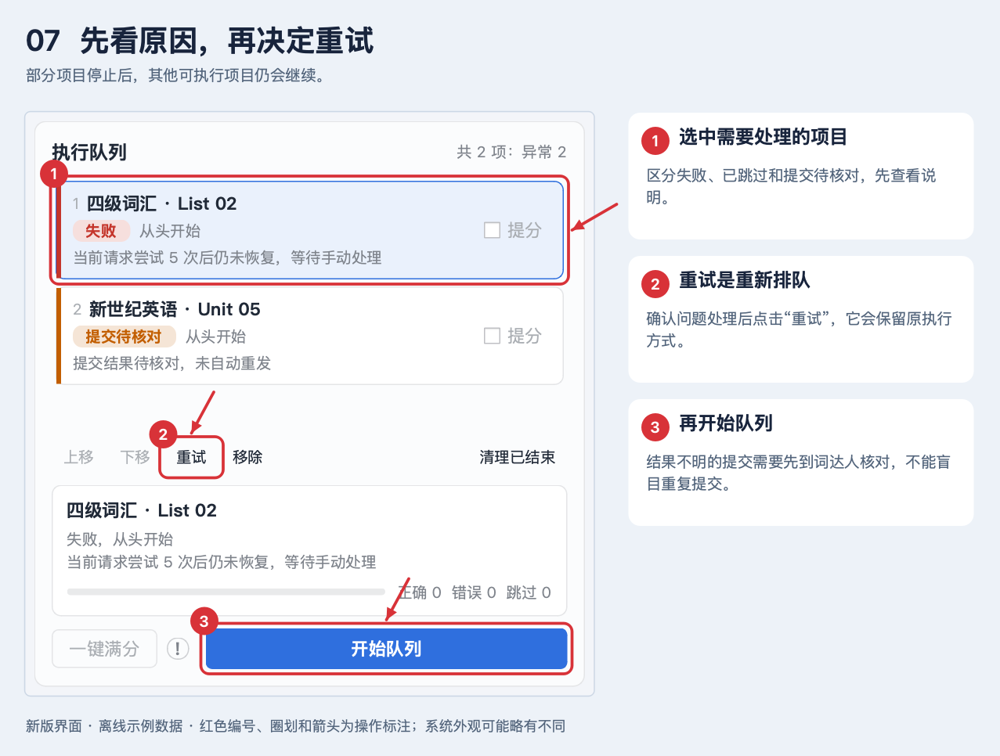
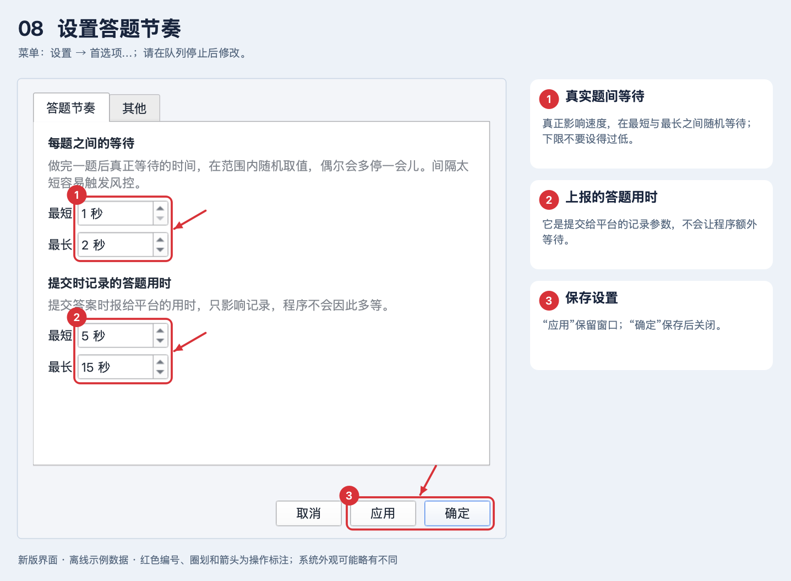
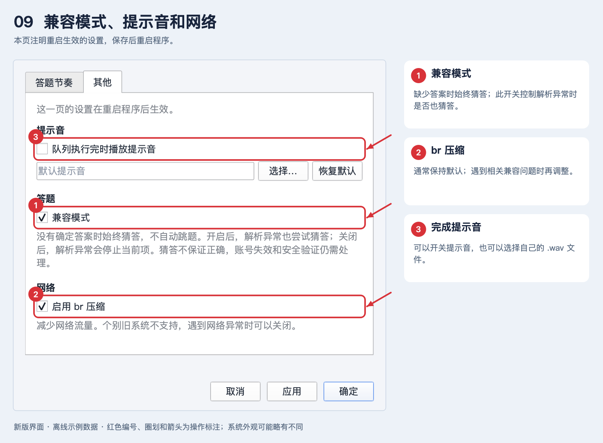

# 词达人小助手使用教程

## 一、启动方式

### Windows：下载 Release 压缩包，解压后运行 EXE

1. 打开项目的 [Releases 页面](https://github.com/Tikzen/Cidaren-Assistant/releases)。
2. 在附件（Assets）中下载 **`CidarenAssistant-Windows-x64.zip`**。
3. **完整解压**压缩包，打开解压后的文件夹。
4. 双击 **`CidarenAssistant.exe`** 启动，无需另外安装 Python。

请保留同目录的资源、依赖文件和 `mitmdump.exe`；内置 Token 工具会自动调用它。请先解压，再运行程序。

### macOS：主页下载源码，运行 `.command` 启动脚本

1. 打开 [项目主页](https://github.com/Tikzen/Cidaren-Assistant)。
2. 点击绿色 **「Code」→「Download ZIP」**，下载源码压缩包。
3. **完整解压**，打开项目文件夹。
4. 双击 **`点我运行_mac.command`**，等待终端检查环境并启动程序。

macOS 源码运行需要 Python 3.12 环境。启动脚本会先检查项目内是否已有 `.venv` 虚拟环境：缺少时尝试创建并安装依赖，已有时直接使用，然后启动主界面。首次安装依赖需要联网，运行过程中保留终端窗口。

如果双击没有成功启动，可以在解压后的项目目录打开终端，运行下面的命令查看错误信息：

```sh
bash ./点我运行_mac.command
```

## 二、获取 Token 并登录

图中的**红色编号**对应操作说明，**圈划**标出需要点击或查看的区域，**箭头**指向操作目标。截图使用新版 UI 和离线示例数据；点击图片可以放大查看。



- **已有 Token：**在图中 **①** 粘贴，点击 **③「登录」**。
- **没有 Token：**点击 **②「获取 Token」**，按下面的步骤获取。
- **需要另一个账号同时运行：**使用 **④「新开窗口」**，每个窗口分别登录。

### 使用内置 Token 获取工具



1. 点击图中 **①「开始获取」**。
2. 在**电脑版微信**中打开词达人学生端并浏览页面。可以从微信中打开 [词达人学生端链接](https://app.vocabgo.com/student/)。**如无反应，请打开词达人任意页面触发请求，推荐点击头像进入个人资料页面。**
3. 按工具提示完成必要的系统授权。捕获成功后，Token 会自动填入主窗口，空闲时自动尝试登录。
4. 需要取消时，使用 **③「停止」或「关闭」**，让工具完成临时代理的恢复。

获取工具会临时设置本地系统代理。**本助手的业务会话默认直连，获取 Token 不会自动暂停正在执行的队列。**

如果当前窗口正在运行，获取的新 Token 只会填入输入框，不会替换当前执行账号。可以等队列停止后登录，或在新窗口使用。

## 三、选中任务并加入队列



1. 在 **①** 点击任务行。按住 `⌘`（macOS）或 `Ctrl`（Windows）可逐项多选；按住 `Shift` 可以选择连续行。
2. 在 **②** 查看完成度和分数：**完成度 100% 表示已做完，成绩 94 分表示还有提分空间。**
3. 点击 **③「加入队列」**，选中的任务排到右侧队尾。
4. 想加入当前分类全部任务时，点击 **④「一键添加全部」**。

任务列表上方可以切换「自学任务」「测试任务」。一键添加全部会包含当前分类中的已完成任务；需要只补分的任务，请先勾选「提分」。

| 按钮 | 作用 |
| --- | --- |
| 加入队列 | 只加入选中任务，方便继续安排顺序；也可以双击任务。 |
| 一键添加全部 | 添加当前分类全部任务，保留各行的提分勾选。 |
| 开始任务 | 先将选中任务加入队尾，再开始执行已有队列。 |
| 开始队列 | 执行右侧已经排好的等待项。 |

已有任务会先执行，新任务排在后面。同一任务、同一种执行方式的等待项或运行项会去重。

## 四、调整顺序并开始队列



- **① 拖动排序：**选中等待任务，按住拖动到希望的位置；虚线箭头演示向前移动。
- **② 上移 / 下移：**选中一个等待项，用按钮微调顺序。
- **③ 开始队列：**按右侧从上到下的顺序执行。

正在执行的项目不能拖动、移除或修改模式。队列运行时仍可添加任务、调整等待项，后续按新的顺序执行。

## 五、从头开始、重做提分和一键满分



### 只想补分：勾选「提分」

图中 **①** 是已完成学习任务的提分勾选。

**选中目标任务 → 确认完成度 100% → 勾选「提分」→ 加入队列 → 开始队列。**

它只处理错词、未满分词，不重新执行整个任务。勾选只是在设置执行方式，还需要加入队列。等待中的队列项也可以调整提分勾选。

**只有完成度 100% 的学习任务可以勾选提分。** 测试任务和未完成任务不能单独勾选；任务还必须支持重做并允许自选单词。

### 希望自动衔接：点击「一键满分」

图中 **②「一键满分」** 位于右侧队列控制区，旁边的圆圈感叹号可以悬浮查看说明。

**先选中左侧目标任务，可多选 → 点击「一键满分」→ 以满分模式加入队尾并开始执行。**

它作用于左侧选中的任务，原有队列项保持各自的模式并先执行。图中 **③** 展示了从头开始、重做提分、一键满分混合排队的情况。

| 执行方式 / 当前状态 | 实际行为 |
| --- | --- |
| 从头开始 | 明确重新完整选词执行；若有进行中小节，先续完，再重新完整选词。 |
| 重做提分 | 只重做已完成任务的错词、未满分词。 |
| 一键满分，完成度不足 100% | 先续做当前刷题流程，再自动提分。 |
| 一键满分，已完成但未满分 | 直接重做提分。 |
| 一键满分，已满分且没有未满分词 | 直接完成，无需重复答题。 |

**一键满分遵循队列顺序。** 其中的提分流程可以有多轮，但有轮数、用时及无进展上限，不会一直重试。是否能够达到满分取决于任务是否支持重做、答案覆盖和运行状态；提分会增加耗时，建议用于有成绩要求的任务。

## 六、查看进度、暂停和中止



- **① 当前运行项：**查看任务名、状态标签、执行模式和最新消息。
- **② 题目进度：**查看当前小节的题数、正确、错误和跳过数量。
- **③ 暂停 / 中止：**根据需要控制执行。

| 操作 | 结果 |
| --- | --- |
| 暂停 | 在请求或题目边界暂停，保留当前位置，按钮会变为「继续」。 |
| 继续 | 从原位置继续推进，不重新开始任务。 |
| 中止任务 | 请求停止当前执行，其他等待项保留；当前请求可能需要返回或超时后才能完全停止。 |

手动暂停时间不计入执行用时额度。需要让任务继续时保留窗口，可以最小化；关闭窗口会请求停止当前运行。

## 七、失败或跳过后怎么处理



1. 选中图中 **①** 对应的项目，先看卡片和详情中的停止原因。
2. 确认问题处理后，点击 **②「重试」**，将它重新排队。
3. 点击 **③「开始队列」** 继续执行。

手动重试沿用原模式：「从头开始」项目会再次走完整选词流程。请先看清模式，再决定如何继续。

| 状态 / 原因 | 该怎么做 |
| --- | --- |
| 已完成 | 当前项成功；队列停止后可点击「刷新任务」查看最新成绩。 |
| 已跳过 | 查看原因，例如不支持重做或无法选词；其他可执行项继续。 |
| 已刷完，未提分 | 普通刷题已完成，提分未完成；先确认成绩和停止原因。 |
| 失败 | 先处理网络或数据问题，再决定是否重试。 |
| 提交待核对 | 先到词达人确认实际进度，再手动恢复；程序不会自动重发结果不明的答案。 |
| 需安全验证 | 到词达人 App 或微信学生端完成验证，再处理对应项目并继续队列。 |
| 登录失效 | 重新获取有效 Token 并登录，剩余等待项保留。 |
| 连续无提升、轮数或用时上限 | 查看仍未满分的词与日志，不要反复启动相同失败流程。 |

程序对当前请求最多尝试 5 次；提分最多 10 轮、30 分钟，连续两轮分数未提升时停止当前提分。普通队列单项也有用时上限。安全验证和账号失效会停止本轮执行，其余等待项保留。

「清理已结束」用于移除历史结果，不会移除等待项和运行项。

## 八、设置答题节奏与兼容模式

先停止当前队列，再通过 **「设置 → 首选项…」** 打开设置。macOS 也可以使用 `⌘,`。

### 两个用时设置有什么区别



- **① 每题之间的等待：**真正影响速度，在最短与最长之间随机取值，偶尔适当延长；下限不要设得过低。
- **② 提交时记录的答题用时：**是报给平台的记录参数，程序不会因此额外等待，不等于任务的实际耗时。
- **③ 应用 / 确定：**「应用」保存并保留窗口，「确定」保存后关闭。

### 其他设置



- **① 兼容模式：**部分数据或解析异常时尝试猜一个答案继续，优先减少中断；它不保证每题答对，也不会忽略账号失效和安全验证。
- **② br 压缩：**通常保持默认，遇到相关兼容问题时再调整。
- **③ 完成提示音：**可开关，也可选择自己的 `.wav` 文件。

界面注明需要重启生效的设置，请保存后重启程序。

## 九、多账号、日志与常见问题

### 多账号同时运行

使用第一张图中 **④「新开窗口」**，或通过「窗口 → 新开窗口（多开）」打开独立窗口。

不同账号可以分别执行自己的队列；同一账号已在其他窗口运行时，当前窗口只查看。答案库、全任务错题记忆、词表池和查词缓存由同一份程序的各窗口共用，无需为每个账号复制一套。

### 日志与数据

主界面底部可以查看运行日志，控制是否自动滚到最新；通过「导出…」或「帮助 → 导出日志…」保存日志。

源码运行时，学习数据保存在项目 `config/`：答案库 `answer_lib.json`、错题记忆 `wrong_memory.json`、词表池 `word_pool.json` 和查词缓存 `word_cache.sqlite3`。更新代码时保留这些本地数据。

队列默认保存在 `~/.cidaren-assistant/queues/`；Windows 优先使用 `%LOCALAPPDATA%/CidarenAssistant/queues/`。异常退出后，等待项与顺序保留，中断项需要先核对进度再恢复。

### 快速排查

| 问题 | 先检查什么 |
| --- | --- |
| 登录失败 | Token 是否完整有效、网络是否可用；其他设备重新登录同账号可能使旧 Token 失效。 |
| 按钮是灰色 | 是否已登录、是否选中任务、当前任务类型和状态是否允许操作。 |
| 提分无法勾选 | 是否为完成度 100% 的学习任务；未完成任务可用一键满分。 |
| 成绩看起来没变 | 队列停止后点击「刷新任务」，以服务器最新返回为准。 |
| 某项一直不能满分 | 查看队列详情和日志，判断是功能不受支持、答案缺失、无进展还是网络问题。 |

需要反馈时，通过 [GitHub Issues](https://github.com/Tikzen/Cidaren-Assistant/issues) 提供操作步骤、任务类型、错误提示与相关日志，并隐藏 Token 和个人账号信息。

## 十、检查更新

1. 打开 **「帮助 → 检查更新」**。可以在任务运行时检查，更新本身需等待队列结束。
2. 窗口显示远端版本、差异文件数量及更新说明。没有差异时无需操作。
3. 关闭获取 Token 窗口和同一目录下的其他多开窗口，再点 **「更新并重启」**。
4. 程序先下载、校验全部所需内容；完成后自动退出，由独立助手替换文件，随后自动启动。无需手动重启。

**Windows：**下载完整发布 ZIP，按 SHA256 校验后只替换有变化和新增的程序文件。首次升级到支持此功能的版本，仍需在 Releases 手动下载一次；保留原 `config/` 和个人数据后升级。

**macOS 源码版：**按 GitHub 主分支的固定提交比较文件内容，只下载差异文件。通过 `.command` 启动的源码版也可使用。若改过程序代码，远端版本会覆盖对应代码，请先自行保存；依赖清单变化时还需要更新 Python 环境。

更新会保留 `config/`、Token、日志、缓存和用户目录中的队列；不会主动删除其他本地文件。旧程序文件备份与更新日志位于用户数据目录的 `updates/stage-*/` 下：Windows 为 `%LOCALAPPDATA%/CidarenAssistant/updates/`，macOS 为 `~/.cidaren-assistant/updates/`。

下载或校验失败时保持当前程序不退出；替换中失败会尝试回滚并重新启动原程序，窗口日志会显示更新结果。若文件被其他程序持续锁定、权限不足或磁盘故障，请保留更新日志反馈，必要时从 Releases 手动恢复。更新不会自动继续执行任务；登录后核对任务进度，再启动队列。

[← 返回项目首页](../README.MD)
